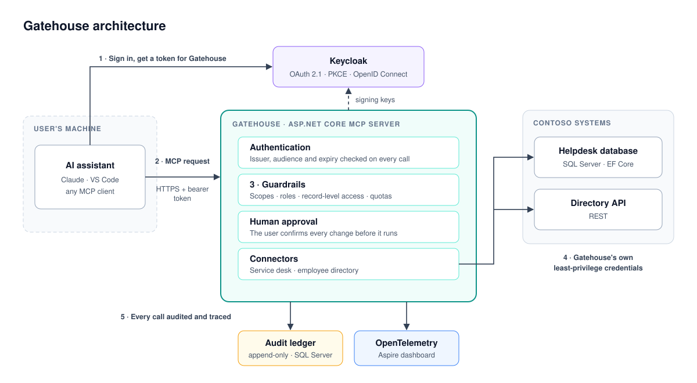

# Gatehouse

**A secure MCP server that lets AI assistants work inside enterprise systems through authenticated, authorized and auditable actions.**

Gatehouse is a Model Context Protocol (MCP) server written in C# that connects AI assistants to a company's internal systems without handing them the keys. Every request is tied to a signed-in user, checked against what that user is allowed to do, confirmed by a human when it changes data, and recorded in an audit trail. The result is a controlled bridge between AI and the business systems it needs to be useful.

## What It Does

- Connects AI assistants such as Claude, VS Code and other MCP clients to enterprise systems.
- Gives secure access to service desk tickets and employee directory data.
- Enforces authentication, authorization, human approval for sensitive actions, and auditing.
- Acts as a controlled bridge between AI and existing business systems.

## Project Focus

- MCP server development in C#
- Enterprise AI integrations
- OAuth 2.1 and identity management
- Least-privilege access control
- Human-in-the-loop approvals
- Auditability and observability
- Legacy system integration

## Architecture

  

1. **Authenticate.** The user signs in through Keycloak, and the AI assistant receives a token scoped to Gatehouse.
2. **Request.** The assistant calls Gatehouse's MCP tools on the user's behalf.
3. **Guard.** Gatehouse validates the user's permissions and applies guardrails, including human approval for any change.
4. **Act.** Connectors interact with the business systems using Gatehouse's own least-privilege credentials.
5. **Audit.** Every action, including denied ones, is audited and monitored.

## Tech Stack

.NET 10 · C# · ASP.NET Core · MCP C# SDK · Keycloak · SQL Server / EF Core · OpenTelemetry · Aspire

## Purpose

Gatehouse is a portfolio and learning project. It shows how AI assistants can be integrated securely into enterprise environments using MCP, modern authentication and auditable access controls. Contoso, the company it connects to, is fictional, and all data is generated.
